# Directorio de Usuarios con Angular y Vue
**Nombre del estudiante:** Victoria Andrade  
**Fecha de entrega:** 17 de noviembre de 2026  
**Repositorio de GitHub:** https://github.com/VictoriaAndradeV/Directorio-Usuarios-Angular-Vue.git

## Descripción

Este proyecto consiste en desarrollar una misma aplicación web utilizando **Angular** y **Vue**, con el propósito de conocer las diferencias entre ambos frameworks.

Las dos aplicaciones consultan usuarios desde la API pública de [JSONPlaceholder](https://jsonplaceholder.typicode.com/users) y permiten visualizar sus datos, buscarlos por nombre y marcarlos como favoritos.

## Tecnologías utilizadas

- **Angular:** TypeScript, HTML, CSS y HttpClient.
- **Vue:** TypeScript, HTML, CSS y Fetch API.
- **Pruebas unitarias:** Vitest.
- **Control de versiones:** Git y GitHub.

## Estructura del repositorio

```text
directorio-usuarios-angular-vue/
├── angular-usuarios/     # Aplicación desarrollada con Angular
├── vue-usuarios/         # Aplicación desarrollada con Vue
├── evidencias/
│   ├── angular/
│   └── vue/
└── README.md
```

## Instalación y ejecución

Para ejecutar los proyectos se requiere Node.js y npm. Es recomendable usar Node.js 22.22.3 , Node.js 24.15.0 o posterior, o Node.js 26 o superior.

### Angular

```bash
cd angular-usuarios
npm install
npm start
```

Abrir **http://localhost:4200/**.

### Vue

Abrir otra terminal desde la carpeta principal del repositorio y ejecutar:

```bash
cd vue-usuarios
npm install
npm run dev
```

Abrir **http://localhost:5173/** (o el puerto que indique la terminal).

**Nota:** No se utiliza `json-server` porque los datos se consultan desde una API pública. No es necesario publicar las aplicaciones.

## Funcionalidades

En ambos frameworks se implementaron:

- Consulta de usuarios mediante una petición HTTP a JSONPlaceholder.
- Tarjetas reutilizables con **nombre, correo electrónico y ciudad**.
- Mensajes de **«Cargando...»** y de error cuando falla la consulta.
- Búsqueda por nombre mientras se escribe.
- Botón para **agregar o quitar favoritos** y contador actualizado.
- Navegación entre **Todos los usuarios** y **Mis favoritos**.

Los favoritos se manejan en el estado de cada aplicación, sin modificar los datos de la API.

## Pruebas unitarias y compilación

Se realizó una prueba unitaria por framework sobre el componente de tarjeta de usuario, verificando la emisión del evento al seleccionar un favorito.

**Angular:**

```bash
cd angular-usuarios
npx ng test --watch=false
npm run build
```

**Vue:**

```bash
cd vue-usuarios
npm run test:unit -- --run
npm run build
```

Los comandos se ejecutan desde la carpeta principal del repositorio, por separado. Las capturas de los resultados se muestran a continuación.

## Evidencias de Angular

**1. Instalación de Angular**

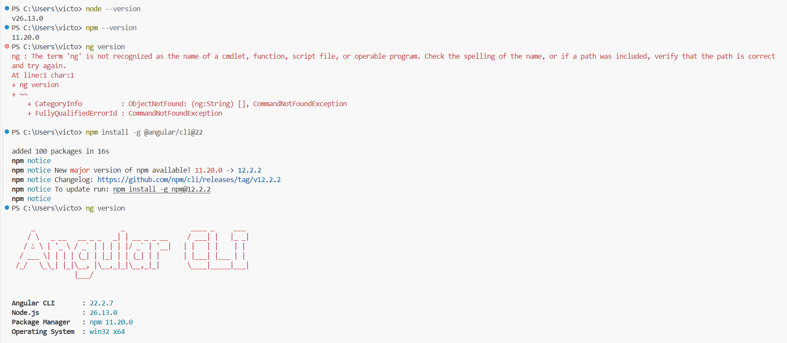

**2. Creación del proyecto y ejecución**

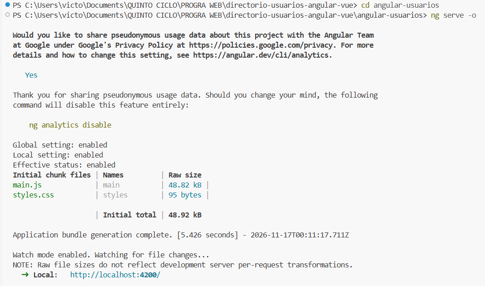

**3. Listado de usuarios**

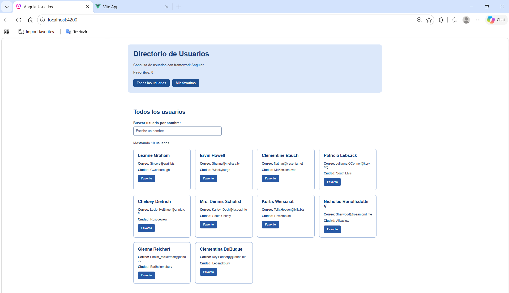

**4. Búsqueda por nombre**

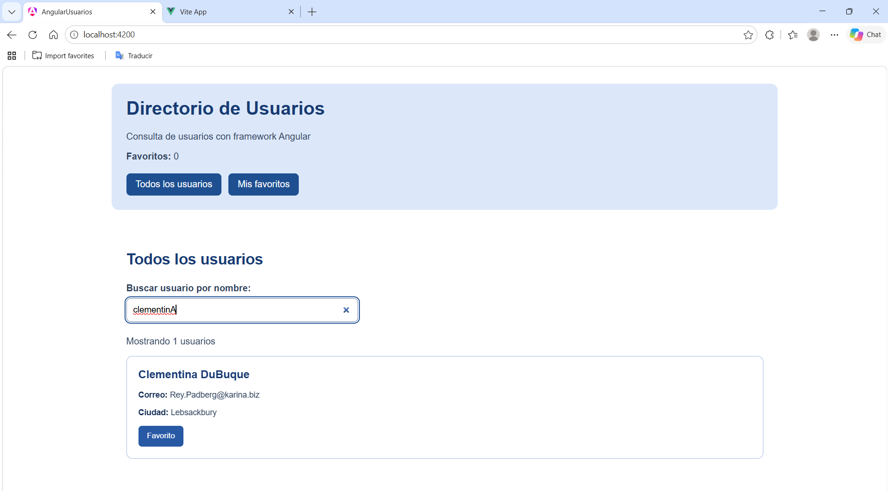

**5. Usuarios favoritos**

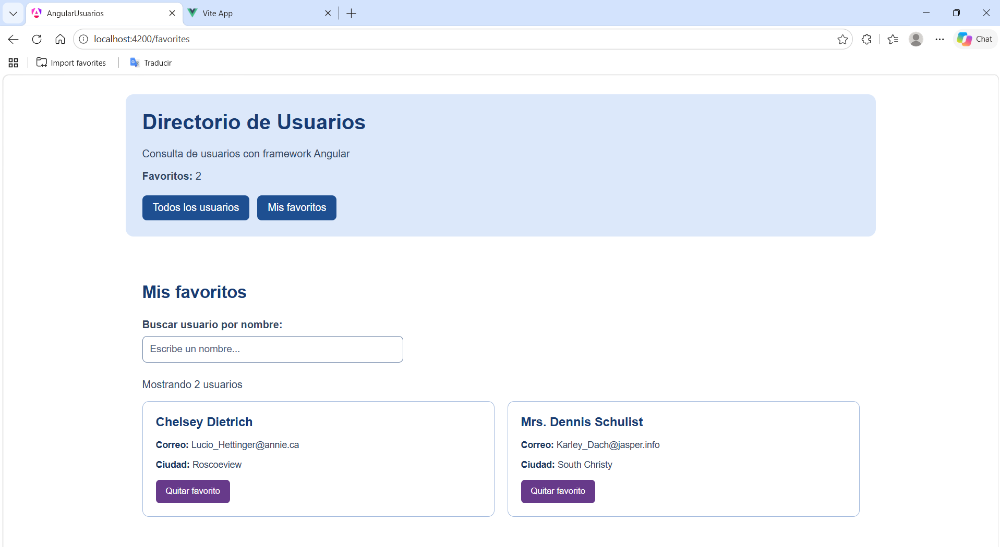

**6. Estado de carga**

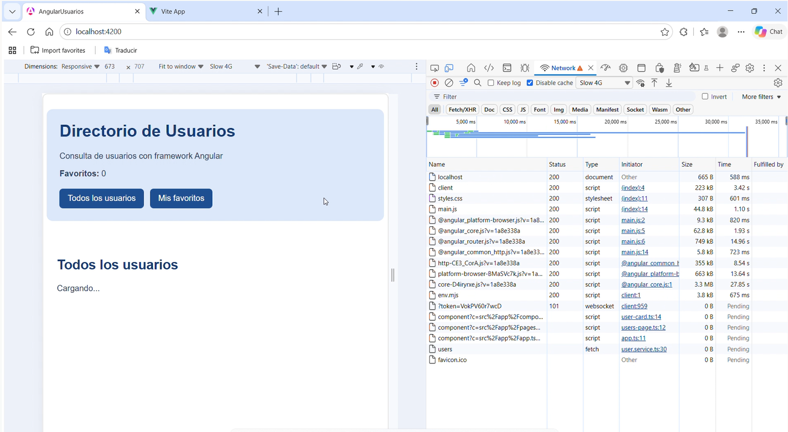

**7. Manejo de error de la API**

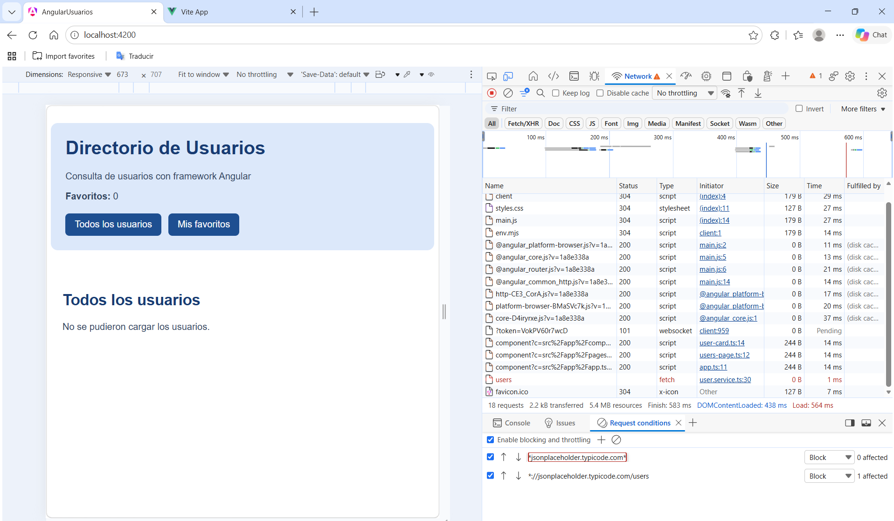

**8. Prueba unitaria**

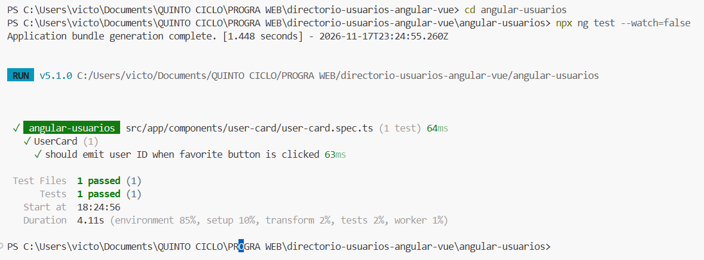

## Evidencias de Vue

**1. Instalación de Vue**

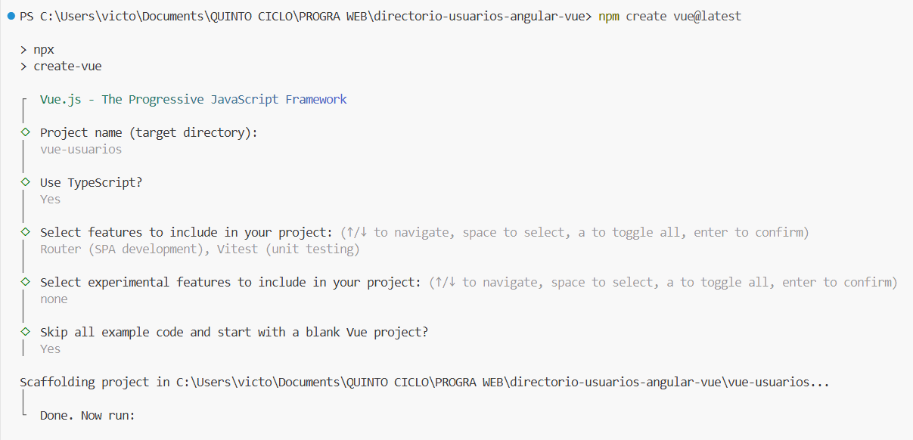

**2. Creación del proyecto y ejecución**

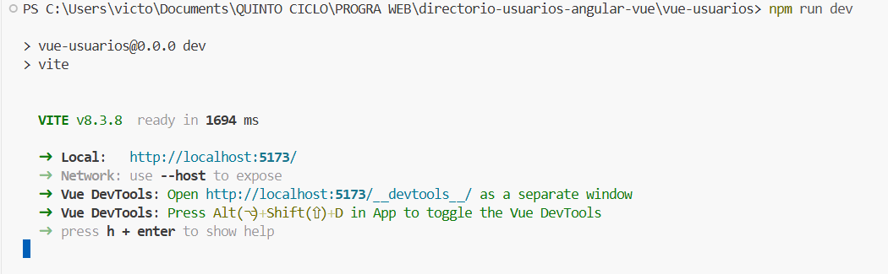

**3. Listado de usuarios**

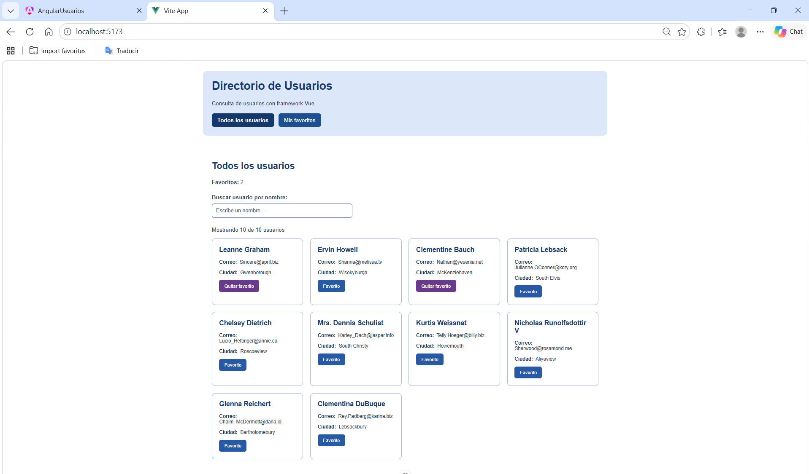

**4. Búsqueda por nombre**

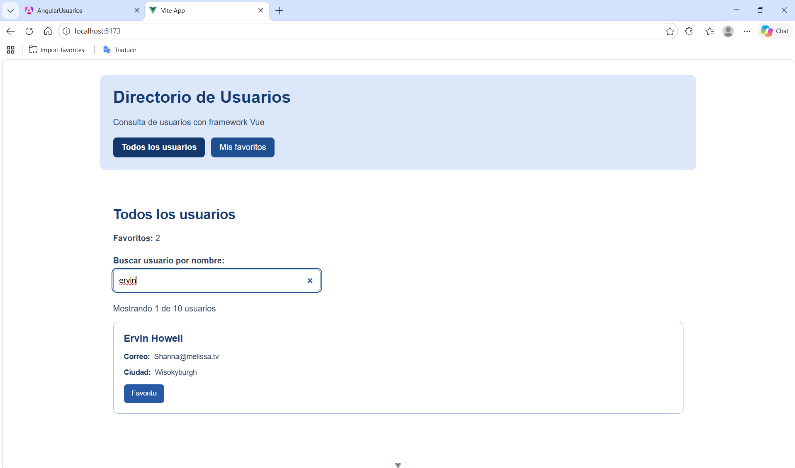

**5. Usuarios favoritos**

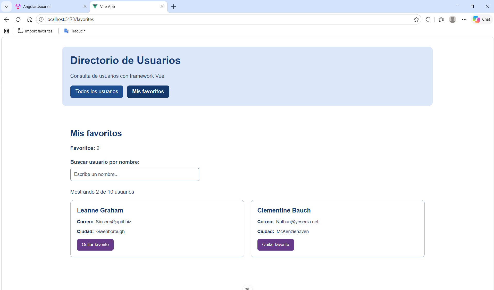

**6. Estado de carga**

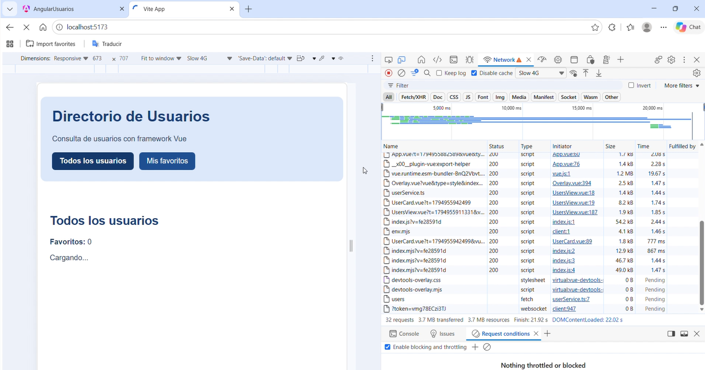

**7. Manejo de error de la API**

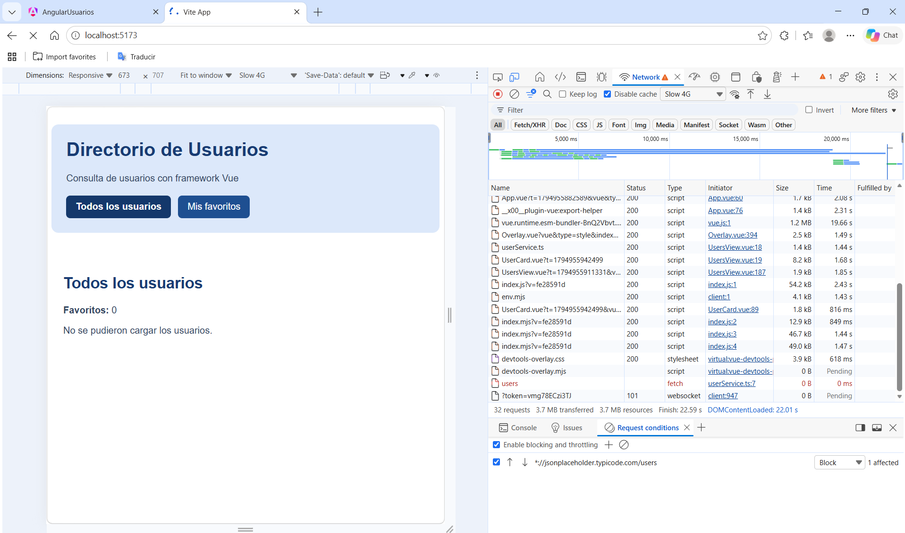

**8. Prueba unitaria**

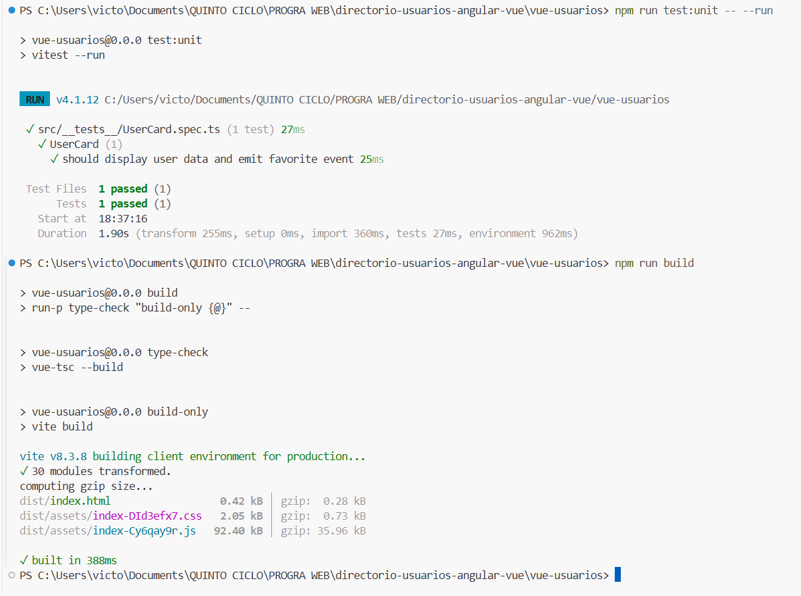

## Conclusión
Desarrollar el mismo directorio en Angular y Vue me permitió comparar la forma de crear componentes, consultar una API y manejar el estado. Aunque utilizan una estructura y sintaxis diferentes, ambos frameworks permiten implementar las mismas funcionalidades.
